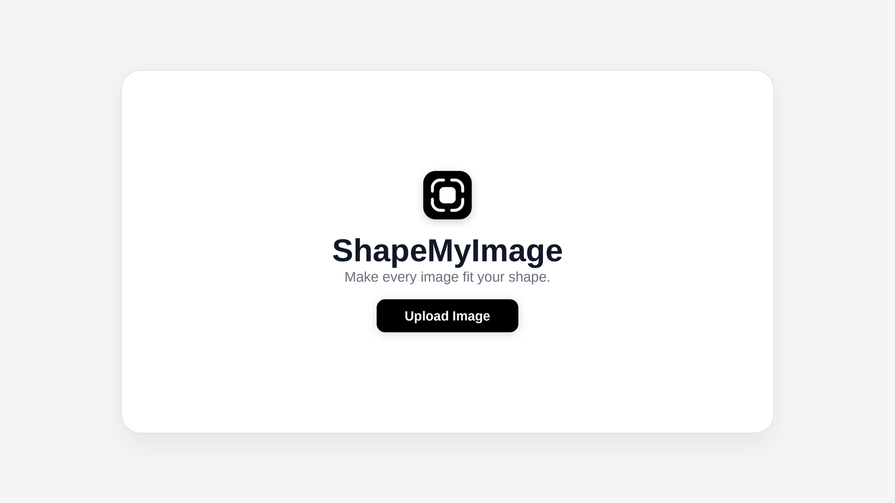

<p align="center">
  
</p>

<h1 align="center">ShapeMyImage</h1>

<p align="center">
  <strong>“make every image fit your shape.”</strong>
</p>

<p align="center">
  <a href="https://github.com/rdrishabh312/shapemyimage/actions"></a>
  <a href="https://www.rust-lang.org/"></a>
  <a href="https://github.com/tokio-rs/axum"></a>
  <a href="LICENSE"></a>
  <a href="#features"></a>
</p>

<p align="center">
  
</p>

ShapeMyImage is a FREE, OPEN-SOURCE, browser-based tool for shaping images, rounding corners, creating circles and ovals, preparing passport-style portraits with face-alignment guides, and exporting transparent PNGs.

built to solve a practical image-editing problem, ShapeMyImage focuses on making everyday image-shaping tasks simple and accessible.

---

## features

- **smart corner rounding:** adapt curvature to square, landscape, and portrait images.
- **multiple image shapes:** create circles, ovals, rounded rectangles, and other supported curved shapes.
- **passport photo framing:** use a portrait preset and visual face-alignment guides.
- **social media assets:** prepare differently shaped images for Instagram Stories, posts, and photo collages.
- **document-ready images:** shape photos for CVs, resumes, presentations, and portfolios.
- **transparent PNG export:** prepare images with genuine transparency outside the selected shape.
- **browser-based workflow:** designed to process images locally rather than upload them to a processing server.

---

## try it

- **live:** [https://smi.vridhika.com/](https://smi.vridhika.com/)
- **source code:** [https://github.com/rdrishabh312/shapemyimage](https://github.com/rdrishabh312/shapemyimage)

---

## quick start

### run with cargo
```bash
cargo run --release
```
then open `http://localhost:3000` in your browser.

### static hosting
the `static/` directory is completely self-contained and can be deployed directly to Cloudflare Pages, Netlify, or any static hosting service.

---

## feedback and contributions

contributions and pull requests are welcome. you can submit pull requests or contribute directly through the repository.

if you use ShapeMyImage in your workflow, i'd love to hear what works well and what could be improved.

see [CONTRIBUTING.md](CONTRIBUTING.md), [CODE_OF_CONDUCT.md](CODE_OF_CONDUCT.md), and [CHANGELOG.md](CHANGELOG.md) for details.

---

## open source license

ShapeMyImage is released under the MIT License. you may use, modify, distribute, and build upon the software according to the license terms.

see the [LICENSE](LICENSE) file for the complete license.
